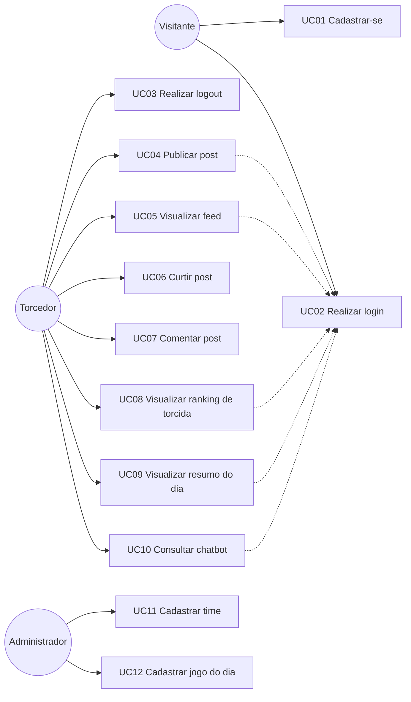

# Artefato 3 — Casos de uso

**Projeto:** Torcida  
**Disciplina:** Análise e Projeto de Sistemas II  
**Professor:** Silvio Rogerio de Lucia  
**Grupo:** Cauê Souza Marinho, Bruno Souza, Erick, Kaique Souza, Guilherme Sousa  
**Data:** 25/08/2026

Este artefato atende à Entrega 2 (requisitos e casos de uso) e já deixa pronto o diagrama pedido na modelagem.

---

## 1. Atores

| Ator | Descrição |
|---|---|
| Torcedor | Usuário autenticado que posta, interage, vê ranking, resumo e chatbot |
| Visitante | Usuário ainda não autenticado |
| Administrador | Usuário com permissão para cadastrar times e jogos |

---

## 2. Diagrama de casos de uso

---

## 3. Lista de casos de uso

| ID | Caso de uso | Ator | Prioridade |
|---|---|---|---|
| UC01 | Cadastrar-se | Visitante | Alta |
| UC02 | Realizar login | Visitante | Alta |
| UC03 | Realizar logout | Torcedor | Alta |
| UC04 | Publicar post | Torcedor | Alta |
| UC05 | Visualizar feed | Torcedor | Alta |
| UC06 | Curtir post | Torcedor | Alta |
| UC07 | Comentar post | Torcedor | Alta |
| UC08 | Visualizar ranking de torcida | Torcedor | Alta |
| UC09 | Visualizar resumo do dia | Torcedor | Alta |
| UC10 | Consultar chatbot | Torcedor | Alta |
| UC11 | Cadastrar time | Administrador | Alta |
| UC12 | Cadastrar jogo do dia | Administrador | Alta |

---

## 4. Descrição dos principais casos de uso

Os dois fluxos abaixo são os mais importantes para o diagrama de sequência da Entrega 3: **login** e **publicar post**. Também se descrevem **ranking** e **resumo/chatbot**, que são o diferencial do projeto.

### UC01 — Cadastrar-se

| Campo | Conteúdo |
|---|---|
| Ator principal | Visitante |
| Objetivo | Criar conta no Torcida informando o time de coração |
| Pré-condição | Visitante não está autenticado; existem times cadastrados |
| Pós-condição | Usuário criado; poderá realizar login |
| Fluxo principal | 1. Visitante acessa a tela de cadastro. 2. Informa nome, e-mail, senha e time de coração. 3. Sistema valida os campos (RF03). 4. Sistema grava o usuário. 5. Sistema confirma o cadastro e encaminha ao login. |
| Fluxos alternativos | A1. E-mail já cadastrado: sistema recusa e pede outro e-mail. A2. Time não informado: sistema impede o envio. A3. Senha com menos de 6 caracteres: sistema recusa. |
| Requisitos | RF01, RF02, RF03, RF29 |

### UC02 — Realizar login

| Campo | Conteúdo |
|---|---|
| Ator principal | Visitante |
| Objetivo | Autenticar-se para usar o sistema |
| Pré-condição | Usuário já cadastrado |
| Pós-condição | Sessão autenticada; acesso ao feed |
| Fluxo principal | 1. Visitante informa e-mail e senha. 2. Sistema verifica as credenciais. 3. Sistema cria a sessão/token. 4. Sistema redireciona ao feed. |
| Fluxos alternativos | A1. Senha ou e-mail inválidos: acesso negado (RF05). A2. Campos vazios: sistema exige preenchimento. |
| Requisitos | RF04, RF05, RF07, RNF01, RNF10 |

### UC04 — Publicar post

| Campo | Conteúdo |
|---|---|
| Ator principal | Torcedor |
| Objetivo | Publicar texto no feed com a etiqueta do time |
| Pré-condição | Torcedor autenticado |
| Pós-condição | Post visível no feed, com etiqueta do time de coração |
| Fluxo principal | 1. Torcedor preenche o campo de post. 2. Opcionalmente anexa imagem. 3. Confirma a publicação. 4. Sistema valida o texto (obrigatório, até 280 caracteres). 5. Sistema grava o post com a etiqueta do time do autor. 6. Sistema atualiza o feed. |
| Fluxos alternativos | A1. Texto vazio: publicação recusada. A2. Texto maior que 280 caracteres: sistema impede o envio. A3. Sem imagem: post é publicado só com texto (válido no MVP). |
| Requisitos | RF08, RF09, RF10, RF13, RN02, RN06 |

### UC08 — Visualizar ranking de torcida

| Campo | Conteúdo |
|---|---|
| Ator principal | Torcedor |
| Objetivo | Ver quais times têm mais torcida na plataforma |
| Pré-condição | Torcedor autenticado; existem usuários cadastrados |
| Pós-condição | Ranking exibido |
| Fluxo principal | 1. Torcedor abre a aba Ranking. 2. Sistema conta os usuários por time. 3. Sistema ordena do maior para o menor. 4. Sistema exibe posição, time e quantidade. |
| Fluxos alternativos | A1. Empate de quantidade: times aparecem na mesma faixa, desempate por nome. |
| Requisitos | RF19, RF20, RF21, RN03 |

### UC09 — Visualizar resumo do dia

| Campo | Conteúdo |
|---|---|
| Ator principal | Torcedor |
| Objetivo | Ver um resumo do dia do seu time de coração |
| Pré-condição | Torcedor autenticado |
| Pós-condição | Card “Resumo do dia” exibido |
| Fluxo principal | 1. Sistema identifica o time de coração do usuário. 2. Sistema busca jogos do dia desse time no banco. 3. Sistema busca posts recentes daquele time, se houver. 4. Sistema monta o texto do resumo. 5. Sistema exibe o card. |
| Fluxos alternativos | A1. Não há jogo do time no dia: resumo informa que não há partida cadastrada. A2. Não há posts recentes: resumo usa só os jogos. |
| Requisitos | RF22, RF23, RN04 |

### UC10 — Consultar chatbot

| Campo | Conteúdo |
|---|---|
| Ator principal | Torcedor |
| Objetivo | Perguntar ao chatbot sobre jogos do dia ou resumo do time |
| Pré-condição | Torcedor autenticado |
| Pós-condição | Resposta exibida na conversa |
| Fluxo principal | 1. Torcedor envia pergunta (ex.: “quais jogos tem hoje?”). 2. Sistema interpreta a intenção (jogos do dia ou resumo do time). 3. Sistema consulta o banco. 4. Sistema devolve a resposta em português. |
| Fluxos alternativos | A1. Pergunta não reconhecida: sistema explica o que pode responder. A2. Nenhum jogo no dia: sistema informa que não há jogos cadastrados. |
| Requisitos | RF24, RF25, RF26 |

### UC12 — Cadastrar jogo do dia

| Campo | Conteúdo |
|---|---|
| Ator principal | Administrador |
| Objetivo | Registrar uma partida para alimentar resumo e chatbot |
| Pré-condição | Administrador autenticado; times cadastrados |
| Pós-condição | Jogo disponível para consulta |
| Fluxo principal | 1. Administrador informa mandante, visitante, data e horário. 2. Opcionalmente informa o placar. 3. Sistema valida os campos. 4. Sistema grava o jogo. |
| Fluxos alternativos | A1. Time inexistente: cadastro recusado. A2. Data inválida: sistema exige correção. |
| Requisitos | RF28, RN05 |

---

## 5. Processos indicados para o diagrama de sequência (Entrega 3)

O professor pede sequência de **pelo menos 2 processos importantes**. Recomendação do grupo:

1. **UC02 Realizar login** — autenticação, base de todo o sistema.
2. **UC04 Publicar post** — fluxo principal da rede social.

Alternativa forte para o diferencial: **UC08 Ranking** ou **UC10 Chatbot**.
